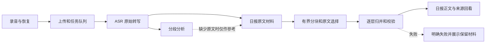

# 修改逻辑

本文解释本轮方案与代码位置。标为“待验证”或“草稿”的部分不应直接作为发布完成项。

## 一、先把识别、理解和显示分开

不能把日报遗漏全部归因于 ASR，也不能让摘要模型悄悄改写原始转写来制造更高识别分。分别验证输入是否完整、事实在哪一层丢失、责任关系是否改变、最终界面是否正确显示。

## 二、App 界面与交互

相关代码：[App 主界面](../../app/src/main/java/com/recnonstop/app/MainActivity.java)、[播放器](../../app/src/main/java/com/recnonstop/app/AudioPlayerSheet.java)、[日报详情](../../app/src/main/java/com/recnonstop/app/ReportDetailActivity.java)。

- 将主流程收敛为“录音 / 记录 / 日报”，电脑连接和设置作为工具入口。
- 录音页使用真实麦克风电平、计时、分段进度及明确异常状态，不能用装饰动画假装有声音。
- 文件按日期组织，播放支持暂停、拖动、前后跳转；离开后释放资源。
- 日报提供 Markdown 阅读、来源回看、离线内容、历史版本与失败重试；已配对、正在同步、分析中和失败应分开呈现。
- 日报历史用时间与版本标识组成稳定游标分页，先过滤空报告再限制页数；仅确认成功落盘的单份报告。不能用“最新已下载”推断较早版本已送达。返回正文恢复阅读位置，选中版本随界面重建保存，失败回退明确显示；同步与重新生成的含义分开。
- 后续真机验收要覆盖录音不中断、导航返回、播放释放、大字体与离线恢复，不能只凭截图评价交互已完成。

## 三、转写可靠性与目标资源

相关代码：[worker](../../pc/worker/worker.py)、[推理门控](../../pc/internal/infer/gate.go)、[服务接线](../../pc/cmd/pc-server/main.go)。

- 长音频最多按 30 秒识别，优先选择低音量切点；模型输出达到长度限制时缩短该块重试，避免静默丢掉后半段。
- 不盲目增益、降噪或压低输入质量；每项声音处理都应有对照，防止弱语音、数字和专名被损伤。
- ASR 与日报共用逐请求并发门控，默认 1。响应读取完成、关闭、错误时释放；排队可取消，健康查询不占推理槽。
- 并行开发和评审不等于并发挤满模型。目标 8GB 环境先限制同时计算，再验证模型同时驻留及完整上下文的峰值。
- 声音标签保留时间窗，不能把一个局部音乐标签扩散到全天，也不能据此抹掉真实任务或判断身份。

## 四、分段分析：信息覆盖、归属与条件

相关代码：[模型调用与提示](../../pc/internal/infer/lmstudio.go)、[结构化类型](../../pc/internal/infer/types.go)、[事实合并](../../pc/internal/infer/facts.go)、[来源校验](../../pc/internal/infer/grounding.go)。

| 原问题 | 修改逻辑 |
| --- | --- |
| 只保留任务，新闻、方法、剧情和广告内容被压没 | 摘要覆盖每个有实质信息的独立话题；保留来源性质，不把引用等同无信息背景 |
| 发言人等于任务负责人 | `speaker` 表示发言来源，`owner` 表示责任归属；正文提到的人名不能伪造声纹或来源编号 |
| 跨录音相同标签被合并为一人 | 匿名来源始终绑定所属录音；没有证据不合并身份 |
| 正常前提被放进风险 | 单独保留 `constraints`；风险需要原文明示的不利事实或条件后果 |
| 复杂否定条件被缩写反向 | 保留否定词、作用对象与前后关系；复杂条件优先保留原句，不能用含混简写改变方向 |
| 重复记录的编号被当次数 | 不从行号或来源编号推业务次数；真正明示的数字仍保留 |
| 自算记录范围或项数 | 识别“记录01至记录48”“共记录89项”等材料未明示的统计；只移除该统计并替换为“多条记录”，保留巡检、任务和尾部约定，不按固定条数截尾 |
| 结构化输出顺序改变结果 | 明确 schema 字段及来源编号顺序，记录实际请求字节；不能只比较重新排序后的 JSON |
| 多段合并漏掉尾部任务 | 保留各段结构化事实并确定性去重，最终合并不自行创造待办和承诺 |

摘要先输出，再输出说话人、任务、限制和风险。正常前提与真实风险的少量合成示例用于说明边界，不写入实际评测答案。JSON 格式回退和纠错共用有限尝试，防止失败后无界重试。

单次材料仍有界；缺省输出预算提高到 4096，显式配置保持不变。增加预算不能替代事实验证，显式旧配置也不会自动获得新预算。

## 五、日报：原文优先，逐层定位丢失

相关代码：[原文材料筛选](../../pc/internal/infer/daily_source.go)、[原文选择](../../pc/internal/infer/daily_extract.go)、[日报提示与调用](../../pc/internal/infer/daily.go)、[有界归并](../../pc/internal/infer/reduction.go)。

1. **构造分析副本。** 有可用原始转写时，移除明确标识的历史自动摘要、待办和风险候选，避免旧错误再次成为“证据”；不改存储的原记录。没有原文才保留清楚标注的自动分析参考。
2. **逐条选择原文。** 分块按来源编号分类为背景表达、具体事项或转述事项；校验编号完整性和合法性。非背景按原顺序恢复完整原句，不能只依赖模型重写后的短摘要。
3. **保留有价值的否定和状态。** 完成、正常、取消、否决和未承诺也是信息；没有新任务或多次重复不是删除它们的理由。当前分类仍有漏选，不能因背景概括偶然补回就称问题根治。
4. **受限归并。** 每次输入控制在既定边界，逐层汇总；不能按固定条数截尾。某层没有缩短时，只对原始有界材料定向重试一轮，仍不收敛就明确失败。
5. **最终责任归属。** 姓名未知不等于任务无人负责。原文能确定匿名来源负责时，保留所属录音及说话人标签；只有归属本身没说明才记为未明确。
6. **保持认识边界。** “没有说”“不能确认”不能改成已确认没有发生或没有影响；普通用途不能改成已经执行。
7. **失败可见。** 请求超时、截断、空响应、非法来源或不收敛都不能显示为成功摘要。保留原文和已有材料，候选内容清楚标注需核对。

只看到前几层正确不够：同一事实必须在原始输入、选择结果、中间归并和最终正文之间逐层核对。接续长任务是执行恢复，不能替代最终质量审阅。

### 长日报分组原型：尚未迁入正式实现

上述逐层归并在真实长材料上出现事实丢失和不收敛。新原型直接枚举完整原文，按有界组生成可读事项、待办、限制与风险；程序恢复每项来源并保留全部有效组的详情，模型最后只生成短概览。短材料仍沿用 C7，避免扩大改动范围。

来源编号覆盖只能证明输入被引用，不能证明每条发言里的所有事实都被保留；仍需独立对照冻结参考评分。每组最多两次尝试，缺来源、截断或后续组失败时明确报错，不把部分报告当成功。还须检查概览与详情一致、风险有原文依据、来源列表是否过长，以及正文是否形成有用概括，而非仅复制转写。

## 六、校验器的边界

相关代码：[依据检查](../../pc/internal/infer/grounding.go)、[风险一致性检查](../../pc/internal/infer/daily_consistency.go)、[来源归属检查](../../pc/internal/infer/daily_attribution.go)、[事件日期检查](../../pc/internal/infer/daily_event_dates.go)。

- 日历依据核对完整年月日关联，而非只查年份是否在全文出现。报告年份不能授权补全无年份的外部事件。
- 录音统计与业务次数分开；提示词、纠错反馈及自动声音标签不充当事实依据。
- 来源不明的引用不能直接写成用户表达或经历。身份依据限定到对应来源，产品中的一般用户描述、否定和引文不应误触发。
- 完整事件日期另做窄范围检查：元数据中的录制日期不能被自动移作外部事件的发生或发布日期。此规则不能证明同一日期与某个事件的语义关联，也不是完整时间推理器。
- 风险一致性检查仅检测“风险与异常”同一章节内，正向风险列表与无限定无风险断言并存的矛盾；不据关键词自行删除真实风险。
- 触发后让模型回原文核对每项风险，保留明确条件，删除无依据的推断；仍共用最多两次尝试，不增加一条无限重试链。
- 已修复“故障已经修复”反例：完成状态只排除对应的局部异常，不连带抹掉同句或其他条目的未解除风险。纯否定、已解除问题、局部无风险、没有其他风险、引文和示例代码均有反例保护；规则仍需接受实际输出验收。
- 规则只能识别有限结构问题，不能被包装成完整语义审查。未知的新错误仍由独立语义评审对照冻结参考发现。

## 七、历史日报重生成

相关代码：[调度器](../../pc/internal/report/scheduler.go)、[本机 API](../../pc/internal/api/api.go)。

增加指定日期的重生成入口，是为了用正式链路对照同一天的新旧报告，不改系统时间或日报设置，不覆盖旧版。历史日期按服务端时区取整日，今天截至当前时刻，未来日期拒绝；空请求保留原入口行为。

本轮已完成可取消等待及既有测试适配，日期边界、夏令时、请求校验、旧版本保留和 API 访问限制的 race 测试通过。显式空日期拒绝，空 body 与空对象保持兼容。尚未部署，仍需正式链路重生成并回读真实报告。

历史同步另见 [分页存储](../../pc/internal/report/history.go) 与 [手机缓存同步](../../app/src/main/java/com/recnonstop/app/DailyReports.java)。删除游标对应的旧报告不影响继续读取后续历史；新报告插入会在下一次从首页同步时获取，不用会产生偏移的页码。确认信息持久化失败时仍保留待送达状态。设备鉴权边界保留，未向手机开放本机管理员的生成接口。

## 八、未采用或禁止的捷径

- 小样本或局部字段通过后，直接宣称“接近助手 80%”。
- 根据失败输出改参考答案、降低关键错误门槛或只报平均分。
- 删除新闻、引用、正常状态等内容来减少风险；或把普通条件一律当异常。
- 用相同模型给自己打分替代独立参考，或把提示中含有答案的原型当泛化证据。
- 因为启用了思考模式就认定更准。有限思考对照仍有遗漏，当前没有整体启用的依据。
- 将未知语音“纠正”为常识推测内容，静默过滤听不清的部分或无依据补年份。
- 用真实宿主机环境变更、增加超量并发或隐去超时来追求表面速度。
